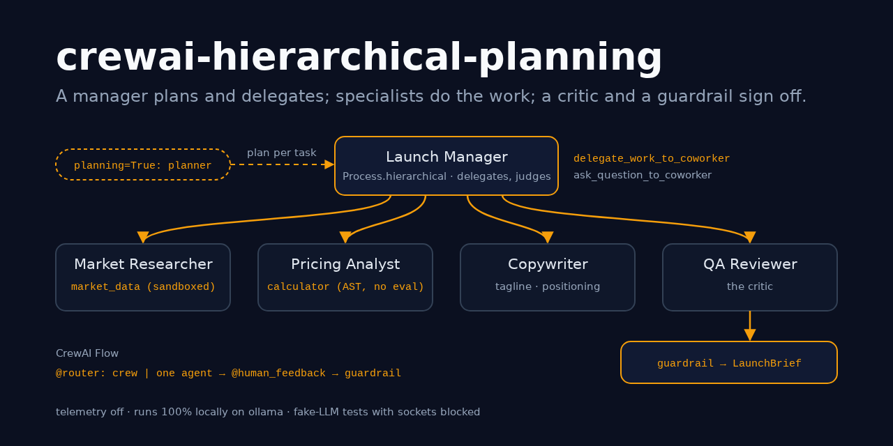
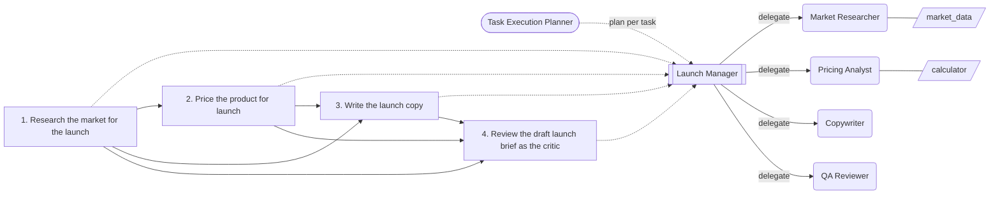
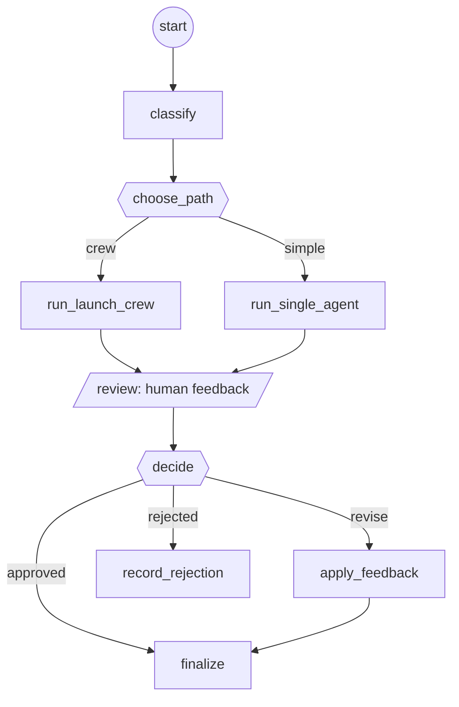

# crewai-hierarchical-planning

> The hierarchical (supervisor) multi-agent architecture with planning, in current CrewAI.
> A manager agent delegates every task of a "product launch crew" to the one specialist
> who owns it: a market researcher with a sandboxed data tool, a pricing analyst with a
> safe calculator, a copywriter, and a QA reviewer who acts as the critic. CrewAI's
> planner writes a plan per task first, and a guardrail validates the final Pydantic
> launch brief. A CrewAI Flow wraps the crew: a router sends simple requests to one
> cheap agent, a person reviews the result through `@human_feedback`, and the rules are
> checked again at the end.

[](https://github.com/MartinCastroAlvarez/crewai-hierarchical-planning/actions/workflows/ci.yml)
[](LICENSE)
[](pyproject.toml)
[](https://docs.crewai.com)
[](pyproject.toml)



**Runs 100% locally, no paid APIs required.** The default model is an open-weight model
on [ollama](https://ollama.com) (`qwen3:4b`) through CrewAI's native
`LLM(model="ollama/...")`. The market data is a small bundled CSV dataset, and the tools
are local and deterministic. CrewAI's telemetry, trace upload and version check are
switched off on import, so the only network peer is your loopback ollama. Memory stays
off too, because CrewAI's default memory embeds with a hosted model. Anthropic is an
optional adapter for your own key. The tests, the example and the benchmark use a fake
model built on CrewAI's `BaseLLM`, and they run with sockets blocked.

## Why

- **One generalist agent with every tool gets lost.** It can't price a product before
  it has researched the market, and it grades its own copy. A manager that hands each
  task to a specialist keeps every prompt small and every tool where it belongs. The
  analyst never sees the dataset tool, and the researcher never sees the calculator.
- **A plan is cheap insurance.** With `planning=True`, CrewAI's planner writes a plan for
  each task before anything runs, and CrewAI appends it to the task description. The
  manager reads it, and the plan travels with the delegation to the specialist. It costs
  one model call.
- **Hierarchy is not free.** The manager spends two model calls per task, one to delegate
  and one to accept the answer, so this crew needs 17 calls where a sequential crew
  needs 9. The [benchmark](#benchmark-sequential-vs-hierarchical-vs-hierarchical--planning)
  measures that, and the Flow's router avoids it for requests that don't need research.
- **Models make things up, so the output has to be checked.** The QA reviewer is a
  critic that strips superlatives and guarantees. A function guardrail then checks the
  brief against the dataset (margin floor, competitive price range, no links), sends it
  back with the exact error, and gives up after N retries. The flow runs the same rules
  again after the human has had a say.

## Quickstart

```bash
pip install "crewai-hierarchical-planning @ git+https://github.com/MartinCastroAlvarez/crewai-hierarchical-planning"
ollama pull qwen3:4b
python -m hierarchical_crew "Plan the launch of Aurora: segments, competitor pricing, price, tagline and risks."
python -m hierarchical_crew --provider fake --feedback approve "Plan the launch of Aurora: segments, competitor pricing, price, tagline and risks."   # offline
python -m hierarchical_crew.bench                                                     # the comparison table
```

`--mode sequential|hierarchical|planning` picks the process, `--manager agent|llm` picks
a custom `manager_agent` or CrewAI's built-in manager from `manager_llm`, `--crew-only`
skips the flow, and `--mermaid flow|crew` prints a diagram. Without `--feedback`, the
flow asks you on the console (CrewAI's `ConsoleProvider`). `python -m examples.quickstart`
runs all three processes and both flow routes offline.

```text
$ python -m hierarchical_crew --provider fake --feedback approve "Plan the launch of Aurora: segments, competitor pricing, price, tagline and risks."
[planning] route=crew (complexity 5) decision=approved status=approved
  Aurora for Parents of newborns (US) at $131.99
  tagline: Meet Aurora, the air-quality monitor for parents of newborns.
  - Indoor monitor for CO2, PM2.5, VOCs and humidity
  - Comes with a 30-day battery and an e-ink display
  - Launch price $131.99
  risk: A cheaper rival exists: Breezely Mini at $79.00
  risk: Low category adoption in the target segment (4.0%)
  qa: Removed an unsupported claim from the tagline: 'Meet Aurora, the best air-quality monitor for parents of newborns.'
  tasks=4 llm_calls=18 delegations=4 -> ['Market Researcher', 'Pricing Analyst', 'Copywriter', 'QA Reviewer'] guardrail_failures=0 seconds=0.103

$ python -m hierarchical_crew --provider fake --feedback 'tagline: "The best lamp, guaranteed"; price $9.99' "Write a tagline for Lumen."
[planning] route=simple (complexity 0) decision=revise status=revised
  Lumen for Early adopters at $30.99
  tagline: The lamp
  ...
  qa: Fixed after the guardrail rejected it: ... price $9.99 is below $30.00, the minimum for a 30% gross margin on a $21.00 unit cost; ...
  tasks=2 llm_calls=5 delegations=0 -> [] guardrail_failures=1 seconds=0.055
```

These are real runs with the **fake** model. CrewAI really runs the hierarchical process,
the delegation tools, the planner, the guardrail and the tools; only the model's words
are scripted. The researcher's numbers come from the bundled CSVs through `market_data`,
and the price comes from the calculator. The copywriter's draft contains "best" on
purpose, so the critic has something to catch. In the second run, the human asked for a
banned claim and a price below cost. The guardrail rejected the edit and the editor
fixed it, so the person was not simply obeyed.

## The crew



Generated from the built `Crew` object (`python -m hierarchical_crew --mermaid crew`):
the process, the manager, the agents and their tools, and each task's `context`.

```python
crew = Crew(
    agents=[researcher, pricing, copywriter, qa],      # allow_delegation=False on all four
    tasks=[research, pricing_task, copy, review],      # no agent: the manager assigns them
    process=Process.hierarchical,
    manager_agent=launch_manager,                      # or manager_llm=LLM(...)
    planning=True, planning_llm=LLM(model="ollama/qwen3:4b"),
    memory=False, cache=False, share_crew=False, tracing=False,
)
review = Task(..., context=[research, pricing_task, copy],
              output_pydantic=LaunchBrief,
              guardrail=make_brief_guardrail(market), guardrail_max_retries=2)
```

- **Delegation.** CrewAI gives the manager two tools, `delegate_work_to_coworker` and
  `ask_question_to_coworker`. The specialists have `allow_delegation=False`, so only the
  manager can delegate and specialists can't bounce work between each other.
- **Context.** `pricing` gets `context=[research]`, `copy` gets research and pricing, and
  `review` gets all three. In hierarchical mode the manager receives that context and has
  to pass it on in the delegation. The tests check that the pricing analyst's prompt
  really contains the competitor prices.
- **Planning.** CrewAI's `CrewPlanner` asks `planning_llm` for a
  `PlannerTaskPydanticOutput` and appends each plan to its task's description. That
  mutates the tasks, which is why `build_crew` builds a fresh crew for every run.
- **Structured output.** The last task returns a `LaunchBrief` (Pydantic). The schema
  only checks shape. Whether the brief is acceptable is the guardrail's call, so a weak
  draft gets a retry with the reason instead of a pydantic crash.
- **Sequential mode** assigns each task to its specialist and drops the manager. It is
  the baseline in the benchmark.

## The flow



Generated from `LaunchFlow.flow_definition()`, CrewAI's static definition of the flow
(`python -m hierarchical_crew --mermaid flow`).

- **`classify`** (`@start`) cleans the request, finds the product in the dataset and
  scores complexity by counting research signals (segments, competitors, pricing,
  risks...). This step makes no model call.
- **`choose_path`** (`@router(..., emit=["crew", "simple"])`) sends a score of at least
  `LAUNCH_CREW_COMPLEXITY_THRESHOLD` (3) to the hierarchical crew. Anything below goes to
  one generalist agent with one guardrailed task: 3 model calls instead of 18.
- **`review`** is decorated with `@human_feedback`. The provider is pluggable: CrewAI's
  console, a `ScriptedFeedback` list for tests and CI, or anything else that implements
  `request_feedback(context, flow)`, such as Slack or a web form. A provider can also
  raise `HumanFeedbackPending` to pause the flow.
- **`decide`** (`@router`) maps the reply with fixed rules. Empty, "approve", "ok" or
  "lgtm" means approved; "reject..." or "no..." means rejected; anything else means
  revise. I chose not to use `@human_feedback(emit=..., llm=...)`, because that asks a
  model to read the human's intent. It costs a call, and a person's "no" should never be
  open to interpretation.
- **`apply_feedback`** runs a one-agent editor task. Both the brief and the feedback go
  in as escaped `<data>` blocks, and the result passes the same guardrail.
- **`finalize`** runs `brief_errors` once more and sets `status` to approved, revised or
  invalid. State is a Pydantic model (`Flow[LaunchState]`).

## Benchmark: sequential vs hierarchical vs hierarchical + planning

`python -m hierarchical_crew.bench` runs the real crews and flows on the Aurora launch.
Only the model is replaced, by `LaunchFakeLLM` with **0.25 s per model call**, so the
numbers measure orchestration (model round trips), not model quality. Measured on
2026-10-25 on a shared 14-core Linux container, Python 3.12.3, crewai 1.15.30, median of
3 runs ([`docs/benchmark/results.json`](docs/benchmark/results.json)):

| Case | Tasks | Delegations | LLM calls | of which planner | Tool calls | Wall clock (s) | Valid brief |
| --- | ---: | ---: | ---: | ---: | ---: | ---: | --- |
| crew: sequential | 4 | 0 | 9 | 0 | 5 | 2.377 | yes |
| crew: hierarchical | 4 | 4 | 17 | 0 | 5 | 4.415 | yes |
| crew: hierarchical + planning | 4 | 4 | 18 | 1 | 5 | 4.654 | yes |
| crew: hierarchical + planning (manager_llm) | 4 | 4 | 18 | 1 | 5 | 4.637 | yes |
| flow: complex request (routed to crew) | 4 | 4 | 18 | 1 | 5 | 4.691 | yes |
| flow: simple request (routed to one agent) | 1 | 0 | 3 | 0 | 2 | 0.780 | yes |

What the numbers say:

- **The manager costs `2 x tasks` calls.** It makes one call to delegate and one to
  accept the result for each of the 4 tasks, which takes the crew from 9 calls to 17
  (+89%) and from 2.4 s to 4.4 s. The specialists' own calls (9) and tool calls (5) are
  the same in every process.
- **Planning costs one call** (+0.24 s here) no matter how many tasks there are, because
  the planner writes all the plans in one structured reply.
- **The custom manager and `manager_llm` cost the same.** The difference is control: you
  write the role, goal and backstory yourself.
- **The router is the real saving.** A request that doesn't need research goes to one
  agent, which takes 3 calls and 0.78 s, a sixth of the crew's cost.
- **What the fake model can't show:** the quality a plan and a manager buy with a real
  model. A fake follows its script either way, so this table only prices the
  orchestration; it does not claim that the extra calls pay off. Judge that on your own
  model and data, and run with `--latency` set to your model's time per call to see
  your own cost side.

## When to use this pattern / trade-offs

Use a hierarchy when the work splits cleanly into **roles with different tools and
different context**, and when someone, whether the manager, a critic or a person, has to
judge the result before it ships. Use plain `Process.sequential` when the order of tasks
is fixed and known. It is the same work with half the model calls. Use one agent for
one-shot requests, and let a router decide.

| Gain | Cost |
| --- | --- |
| Each specialist sees only its task, its context and its tools | The manager spends 2 calls per task |
| The manager can re-delegate, ask a question, or redo a task after a guardrail failure | A weak manager model can delegate to the wrong role or loop, so you need caps |
| `planning=True` makes the strategy explicit in every task prompt | One more call, and plans mutate task descriptions (build a fresh crew per run) |
| Critic plus guardrail catch unsupported claims and bad prices | Each guardrail retry repeats the whole task |
| A Flow adds routing, human review and state around the crew | More moving parts to test, so this repo tests them all |

**Bounding the hierarchy.** The manager's `max_iter` (6) forces a final answer after N
steps of a task. On top of that, a `before_tool_call` hook caps delegations per run
(`LAUNCH_CREW_MAX_DELEGATIONS=8`). Once the cap is reached, CrewAI shows the manager
"Tool execution blocked by hook". Specialists can't delegate at all.

## Configuration

| Variable | Default | Meaning |
| --- | --- | --- |
| `LAUNCH_CREW_PROVIDER` | `ollama` | `ollama`, `anthropic` (optional extra + your key) or `fake` |
| `LAUNCH_CREW_MODEL` | `qwen3:4b` / `claude-sonnet-5-5` | worker model |
| `LAUNCH_CREW_MANAGER_MODEL` | the worker model | manager and planner model (e.g. a bigger one) |
| `OLLAMA_HOST` | `http://127.0.0.1:11434` | must be loopback unless the next variable is `1` |
| `LAUNCH_CREW_ALLOW_REMOTE_OLLAMA` | unset | `1` allows a non-loopback ollama |
| `LAUNCH_CREW_TEMPERATURE` | `0` | sampling temperature |
| `LAUNCH_CREW_MODE` | `planning` | `sequential`, `hierarchical` or `planning` |
| `LAUNCH_CREW_MANAGER` | `agent` | `agent` (custom `manager_agent`) or `llm` (`manager_llm`) |
| `LAUNCH_CREW_MAX_DELEGATIONS` | `8` | delegations per crew run (hook-enforced) |
| `LAUNCH_CREW_MAX_ITER` | `6` | CrewAI `max_iter` for every agent |
| `LAUNCH_CREW_GUARDRAIL_RETRIES` | `2` | `guardrail_max_retries` on brief tasks (0-5) |
| `LAUNCH_CREW_COMPLEXITY_THRESHOLD` | `3` | flow sends scores at or above this to the crew |
| `LAUNCH_CREW_DATA_DIR` | bundled CSVs | a folder with `products.csv`, `segments.csv`, `competitors.csv` |
| `LAUNCH_CREW_FAKE_LATENCY` | `0` | seconds per call for the `fake` provider |
| `LAUNCH_CREW_VERBOSE` | unset | `1` turns on CrewAI's console output |

Set by the package on import, and you can't turn them off: `CREWAI_DISABLE_TELEMETRY=true`,
`CREWAI_DISABLE_TRACKING=true`, `OTEL_SDK_DISABLED=true`, `CREWAI_TRACING_ENABLED=false`,
`CREWAI_DISABLE_VERSION_CHECK=true` (see [`hierarchical_crew/offline.py`](hierarchical_crew/offline.py)).
For Anthropic, install `pip install "crewai-hierarchical-planning[anthropic] @ git+…"`,
then set `ANTHROPIC_API_KEY` and `LAUNCH_CREW_PROVIDER=anthropic`. This project never
calls a hosted API itself.

## Testing

```bash
poetry install --all-extras && poetry run pytest     # 138 tests, 97% coverage, ~8 s, offline
```

`LaunchFakeLLM` subclasses CrewAI's `BaseLLM`, the documented extension point for custom
models. CrewAI drives it exactly as it would drive ollama, through the ReAct executor,
the delegation tools, the planner, the converter and guardrail retries. The fake reads
the agent role and the prompt and answers as that agent would, and tests can script any
role with canned replies. An autouse fixture replaces `socket.connect`,
`create_connection` and `getaddrinfo` with a function that fails the test, so the whole
suite proves that there are no network calls. The tests cover:

- **delegation:** the manager delegates research → Market Researcher, pricing → Pricing
  Analyst, copy → Copywriter, review → QA Reviewer, in that order. Each specialist only
  ever sees its own task, the upstream context reaches it, and the built-in
  `manager_llm` manager behaves the same;
- **planning:** the planner is the first call and returns `PlannerTaskPydanticOutput`.
  Plan *N* is in every manager prompt for task *N* and in the delegated specialist's
  prompt, and there is no plan without `planning=True`;
- **guardrails:** three bad briefs fail `guardrail_max_retries=2` with CrewAI's
  exception. One bad brief gets the error back, the critic repairs it, and in
  hierarchical mode the retry goes back through the manager. Every business rule has its
  own case;
- **bounds:** the delegation cap blocks the third delegation, `max_iter` ends a manager
  that never stops, and a delegation to an unknown coworker reaches nobody;
- **flow:** both router branches and the threshold; approve, revise and reject; feedback
  that breaks policy gets corrected, not obeyed; `finalize` re-checks the rules; the
  console provider is the default; the human sees a `LaunchBrief`;
- **security:** the calculator refuses `__import__`, attributes, names, power towers and
  long input. The dataset loader refuses symlinked files and folders, foreign columns and
  oversized files. An AST test bans `eval`/`exec`/`pickle`/`subprocess`/`shell=` and
  silenced findings, and no agent has a code-execution tool.

## Part of the series

| Repo | Framework | Architecture |
|---|---|---|
| [langgraph-parallel-agents](https://github.com/MartinCastroAlvarez/langgraph-parallel-agents) | LangGraph | Parallelization / map-reduce (fan-out, fan-in) |
| [langgraph-plan-and-execute](https://github.com/MartinCastroAlvarez/langgraph-plan-and-execute) | LangGraph | Planning (plan → execute → replan) |
| [langgraph-reflection-agent](https://github.com/MartinCastroAlvarez/langgraph-reflection-agent) | LangGraph | Reflection (Reflexion: draft → critique → revise) |
| [langgraph-short-long-term-memory](https://github.com/MartinCastroAlvarez/langgraph-short-long-term-memory) | LangGraph | Memory: short-term (checkpointer) vs long-term (store) |
| [adk-sequential-pipeline](https://github.com/MartinCastroAlvarez/adk-sequential-pipeline) | Google ADK | Sequential pipeline + generator↔critic loop |
| [adk-vertex-memory-bank](https://github.com/MartinCastroAlvarez/adk-vertex-memory-bank) | Google ADK | Long-term memory (Vertex AI Memory Bank) |
| [adk-vertex-vector-search](https://github.com/MartinCastroAlvarez/adk-vertex-vector-search) | Google ADK | Agentic RAG (Vertex AI Vector Search) |
| ✅ **crewai-hierarchical-planning** | CrewAI | Hierarchical / supervisor with planning |
| [langchain-tag-agent](https://github.com/MartinCastroAlvarez/langchain-tag-agent) | LangChain | Tool-using ReAct agent with Table-Augmented Generation (TAG) |
| [langsmith-agent-evals](https://github.com/MartinCastroAlvarez/langsmith-agent-evals) | LangSmith + LangGraph | Evaluation / observability, LLM-as-judge critic |
| [agentic-architectures](https://github.com/MartinCastroAlvarez/agentic-architectures) | framework-free | Catalog: ReAct, router, sequential, parallel, loop, reflection, critic, planning, supervisor, swarm/handoff, debate, human-in-the-loop, memory |
| [s3-agent-memory](https://github.com/MartinCastroAlvarez/s3-agent-memory) | LangGraph store | Agent memory (long-term, S3) |
| [agent-model-router](https://github.com/MartinCastroAlvarez/agent-model-router) | — | Router |

More from the same author: [local-rag-ollama](https://github.com/MartinCastroAlvarez/local-rag-ollama) ·
[ui-review-agent](https://github.com/MartinCastroAlvarez/ui-review-agent) ·
[pytest-llm-evals](https://github.com/MartinCastroAlvarez/pytest-llm-evals) ·
[repo-graph-mcp](https://github.com/MartinCastroAlvarez/repo-graph-mcp) ·
[agent-lint](https://github.com/MartinCastroAlvarez/agent-lint) ·
[django-admin-mcp-api](https://github.com/MartinCastroAlvarez/django-admin-mcp-api).

## Contributing

See [`CONTRIBUTING.md`](CONTRIBUTING.md), [`ARCHITECTURE.md`](ARCHITECTURE.md),
[`SECURITY.md`](SECURITY.md) and the agent contract in [`CLAUDE.md`](CLAUDE.md).

## License

MIT © 2026 Martín Castro Álvarez. See [LICENSE](LICENSE). The bundled market dataset is
fictional and ships under the same license; see
[`hierarchical_crew/data/README.md`](hierarchical_crew/data/README.md).
